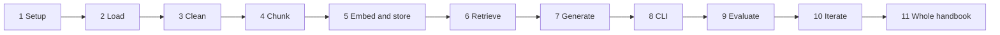

# rag-handbook

This project builds a Retrieval-Augmented Generation (RAG) system from scratch over the [GitLab public handbook](https://handbook.gitlab.com/): 4,621 pages, split into 48,420 chunks. Plain Python implements every stage, with no LlamaIndex or LangChain. The system answers questions about the handbook, cites the section behind each answer, and replies "Not in the handbook." when the pages hold no answer. The project tuned each step on a small index first (3 sections, 93 pages) and indexed the whole handbook last. The full experiment and decision log sits in [docs/experiments.md](docs/experiments.md).

## Results

133 hand-written questions test the system: 33 in [eval/questions.yaml](eval/questions.yaml) and 100 in [eval/questions_full.yaml](eval/questions_full.yaml). The 100 come from many sections (finance, legal, security, support, IT, engineering, marketing, sales and others) and form the main test. Only the top 6 chunks reach the answer model, so "top 6" shows how often the answer is available to it. DeepSeek writes the answers, and an automatic grader scores each one as correct, partial or wrong.

Retrieval uses the 95 answerable questions of the 100, and rows with LLM steps average 3 runs.

| Retrieval setup | Answer chunk ranked first | Answer chunk in top 6 | MRR | Correct / partial / wrong (100 questions) |
|---|---|---|---|---|
| Vector search only | 45% | 75% | 0.58 | not run |
| Hybrid: vector plus BM25 keywords (default) | 48% | 81% | 0.60 | 76 / 12 / 12 |
| Hybrid plus LLM reranker | 75% | 88% | 0.81 | not run |
| Hybrid plus query rewriting plus reranker | 79% | 94% | 0.85 | 87 / 8 / 5 |

**Best setup by question level** (hybrid plus rewriting plus reranker)

| Level | Questions | Ranked first | In top 6 | MRR | Correct answers |
|---|---|---|---|---|---|
| Easy | 20 | 87% | 98% | 0.90 | 19 of 20 |
| Medium | 25 | 85% | 95% | 0.90 | 21 of 25 |
| Hard | 25 (5 traps) | 87% | 100% | 0.92 | 23 of 25 |
| Everyday | 30 | 63% | 86% | 0.73 | 24 of 30 |
| All | 100 | 79% | 94% | 0.85 | 87 of 100 |

The 5 trap questions have no answer in the handbook, so they count only in the answer column. Every setup refused them correctly.

**Test and optimize phase** (small index of 1,574 chunks, the original 33 questions, 31 of them answerable)

| Retrieval setup | Ranked first | In top 6 | MRR | Correct / partial / wrong |
|---|---|---|---|---|
| Vector search only | 61% | 87% | 0.71 | 28 / 3 / 2 |
| Hybrid (default) | 61% | 90% | 0.73 | 30 / 3 / 0 |
| Hybrid plus reranker | 81% | 94% | 0.87 | 28 / 5 / 0 |
| Hybrid plus rewriting plus reranker | 85% | 97% | 0.90 | 30 / 3 / 0 |

On the first 23 questions, deepseek-flash answered 22 correctly and the local qwen2.5:3b answered 15, so the answer model limited quality more than retrieval did at that stage.

**Effect of scale** (the original 33 questions on both indexes)

| Measure | Small index (1,574 chunks) | Whole handbook (48,420 chunks) |
|---|---|---|
| Hybrid, answer chunk in top 6 | 90% | 84% |
| Hybrid, correct answers | 30 of 33 | 25 of 33 |
| Rewriting plus reranker, answer chunk in top 6 | 97% | 91% |
| Rewriting plus reranker, correct answers | 30 of 33 | 28 of 33 |

## Evaluation of the results

- **Retrieval works well with the full pipeline.** Rewriting plus reranking puts the answer chunk in front of the answer model for 94% of answerable questions and ranks it first for 79%. The default hybrid search does so for 81% and 48%.
- **Answers follow retrieval.** 87 of 100 answers are fully correct and 95 are correct or partial. All 5 questions without an answer got the refusal.
- **Scale lowers the default setup, and the full pipeline recovers most of it.** On the same 33 questions, hybrid search falls from 90% to 84% in the top 6 and rewriting plus reranking falls from 97% to 91%.
- **Everyday wording is the weak spot.** Only 63% of everyday questions rank first, against 85% to 87% for the other levels. The handbook says "co-working space" where people say "WeWork". The default hybrid search bridges such gaps for only 57% of everyday questions in the top 6, and rewriting plus reranking lifts that figure to 86%.
- **The remaining errors split in two.** With the best setup, 13 answers are not fully correct. In 5 of them no retrieved chunk held the answer. In 8 the right chunk was retrieved, and most of those answers are partial: they omit one detail, such as a deadline or a condition.
- **Quality costs time.** Hybrid search answers in about 3 seconds. Rewriting plus reranking takes about 15 seconds per question and needs the DeepSeek API.

The numbers compare setups on one question set. No external benchmark covers this corpus.

## Limitations

| Area | Limitation |
|---|---|
| Questions and grading | One author wrote and labelled all 133 questions, and each question quotes a fact from the page that holds its answer. Most questions need one page, so answers that combine several pages get little testing. An automatic grader scored the answers, and a review covered the reason behind every non-correct grade but not the correct ones. |
| API dependency | Rewriting, reranking and the fast answers send questions and chunks to DeepSeek. That works for a public handbook and not for private documents. The local model (qwen2.5:3b) answers in 60 to 80 seconds and got 15 of 23 first-test questions right. |
| Speed | Reranking adds about 12 seconds per question. Embedding the whole handbook took 372 minutes on a CPU, so any change of chunking or embedding model costs the same again. |
| Untested choices | Chunk size (500 tokens, 50 overlap), other embedding models and merging of tiny chunks (about 7% of chunks) have no experiments yet. |

## Questions and metrics

The 133 questions come in four levels (original 33 plus new 100).

| Level | Questions | What it tests | Example |
|---|---|---|---|
| Easy | 6 + 20 | One fact, in the handbook's own words | What does CREDIT stand for? |
| Medium | 9 + 25 | Paraphrased wording, or one item inside a list or table | Are skip-level meetings recorded? |
| Hard | 8 + 25 | Combining facts, a calculation, or no answer at all | Who won the GitLab company chess tournament in 2024? (no answer exists) |
| Everyday | 10 + 30 | Plain wording, the way a person really asks | Can I pay for my WeWork membership with the purchasing card? |

| Metric | Meaning |
|---|---|
| Rank | Position of the chunk that holds the answer in the retrieved list. Rank 1 means closest. |
| Ranked first (hit@1) | Share of questions whose answer chunk is at rank 1. |
| In top 6 (hit@6) | Share whose answer chunk is at rank 6 or better. This matters most, because only 6 chunks reach the answer model. |
| MRR | Average of 1 divided by the rank. 1.0 means the answer always ranks first. |
| Answer grade | An automatic grader compares each answer with the expected one and marks it correct, partial or wrong, with a reason. |

## The journey

| Step | What it does |
|---|---|
| 1 Setup | Python 3.12, pinned dependencies, one config file |
| 2 Load | Reads each file into a page with URL, title and section, and skips the 4 draft pages |
| 3 Clean | Strips Hugo shortcodes, HTML and link URLs |
| 4 Chunk | Splits pages at headings into chunks of up to 500 tokens, with a "Title > Heading" prefix and a deep link |
| 5 Embed and store | Writes `nomic-embed-text` vectors into Chroma, and resumes after an interruption |
| 6 Retrieve | Merges vector and BM25 rankings with Reciprocal Rank Fusion, optionally rewrites the query and reranks the top 20 |
| 7 Generate | Puts the top 6 chunks in the prompt as numbered sources and maps the citations to links |
| 8 CLI | Runs a chat loop; `--debug` shows the retrieved chunks and their scores |
| 9 Evaluate | Scores retrieval and answers on the question set |
| 10 Iterate | Changes one thing at a time on the small index and keeps it only when the numbers improve |
| 11 Whole handbook | Embeds all 48,420 chunks, adds 100 questions from the other sections and repeats the tests |

GitLab licenses the handbook content under CC BY-SA 4.0. This repository holds only the code and evaluation around it.
